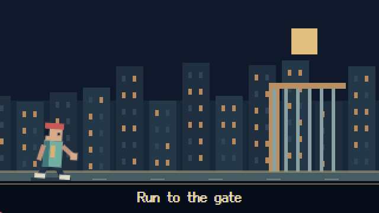

# Pixel Video

**给 UP 主制作像素风视频素材和短片用的创作插件。** 把音频、角色参考与创作想法，做成有场景、有人物动作、带对应字幕的视频素材，再放进自己的剪辑流程。

面向 Claude Code / Codex，采用 **skill + 本地工具** 的方式。当前是可以本地运行和继续改造的早期版本。

图片负责角色、背景和道具，代码负责动作与镜头，FFmpeg 负责合成。工具包不包含视频生成模型，也不绑定图片或语音 API。

## 给 UP 主怎么用

给 agent 一段音乐、口播或其他音频，再提供人物照片、画风参考和想表现的内容。它会协助拆分镜头、准备像素角色与场景、编排动作、对上字幕，最后交付 MP4、SRT 和可继续修改的工程。

你可以把它用于整段像素短片，也可以只做某个桥段需要的素材：人物登场、剧情过场、动作演出、歌词画面或转场。导出的 MP4 可以继续导入剪辑软件，与自己的其他素材一起剪；原始图片和代码留在工程里，方便改动作、换场景和重新导出。

例如：

> 帮我把这段 20 秒音频做成像素风视频素材。主角参考这张照片，要有跑向车、开门上车和起跳落地的动作；字幕对应音频，生成图片和工程保存在我的目录里。

目前还需要 agent 根据内容进行创作与检查，不是上传音频后完全无人干预的一键成片服务。

## 现在能做什么

- 裁音频并记录选段来源，转换/平移已有字幕时间轴。
- 新建可编辑的 Canvas 视频工程；按内容编排镜头、姿势和道具交互。
- 本地预览，导出分镜静帧、烧录字幕的 MP4 和独立 SRT。
- 检查镜头覆盖、字幕区间、资源、输出帧数与视频解码。

skill 中沉淀了真实迭代的经验：动作要有准备、接触和结果；透明图集要检查 alpha；数字要准确绘制；挂点按姿势校准。歌曲案例留作设计经验，默认包不带该歌曲和艺人照片。

## 下载源码

当前通过 GitHub 源码分发，**暂不发布 npm 包**。

**方式一：直接下载 ZIP**

1. 点击本仓库上方绿色的 **Code** 按钮。
2. 选择 **Download ZIP**。
3. 解压到你自己的目录，然后用终端或 CC / Codex 打开该目录。

**方式二：使用 Git**

克隆本仓库：

```sh
git clone https://github.com/Ol1ver0413/pixel-video-plugin.git pixel-video
cd pixel-video
```

以后进入这个源码目录运行 `git pull` 就能更新。ZIP 下载的用户可以重新下载新版，并保留自己另外创建的作品工程。

仓库根目录不需要运行 `npm install`，也没有 `npm install pixel-video` 这样的安装步骤。下文在**作品工程**中运行的 `npm install` 只用于安装浏览器渲染依赖。

## 快速试一下

先安装 [Node.js 当前 LTS 版本](https://nodejs.org/en/download)（工具最低要求 20+）和 [FFmpeg](https://ffmpeg.org/download.html)（包含 `ffprobe`），确保终端里能找到它们。浏览器使用本机 Chrome/Edge，或者在新建的作品工程中安装 Playwright Chromium。

在下载并解压的源码目录里运行：

```sh
node skills/pixel-video/scripts/pixel-video.mjs doctor
node skills/pixel-video/scripts/pixel-video.mjs init --out ./projects/demo --demo
cd projects/demo
npm install
npm run check
npm run render
npm run dev
```

`--demo` 生成八秒合成提示音与三个原创像素动作镜头，用来检查本机能否完成整条流程。正式制作时用 `--audio /path/my-audio.wav`，提供字幕、参考和创作意图，再让 agent 修改分镜与 `src/scenes.js`。当前工具不会自动转写，也不会从任意音频独立判断语义。

渲染完成后，视频在 `projects/demo/output/video.mp4`，字幕在同目录的 `captions.srt`。预览服务默认显示本地地址；端口被占用时可以用 `PORT` 换端口。

如果提示缺少浏览器，可在 `projects/demo` 中运行 `npx playwright install chromium`；如果提示找不到 FFmpeg，先把 FFmpeg 所在目录加入 PATH，再重新打开终端。

下面是模板生成的动作样例，用来验证工具链；正式作品的人物与场景由 agent 根据你的素材重新设计：



[下载样例 MP4](docs/demo.mp4)

## 在 agent 里使用

下载源码后，将下面的路径替换成你解压后的**源码目录绝对路径**；路径有空格时保留引号。

Claude Code 本地试用：

```sh
claude --plugin-dir "/absolute/path/pixel-video"
```

然后输入 `/pixel-video:pixel-video`，附上素材与要求。也可将本目录作为本地 marketplace 添加后安装。

Codex 本地安装命令（修改宿主设置，按需自行执行）：

```sh
codex plugin marketplace add "/absolute/path/pixel-video"
codex plugin add pixel-video@pixel-video-local
```

在新会话使用 `$pixel-video`。这两个宿主共享同一份 skill 和工程模板，插件清单分别适配；`plugin.json` 同时提供 portable 格式。插件需要能运行本地命令，具体可用工具仍取决于宿主。

## 开发与验证

仓库没有运行时 npm 依赖，依赖在生成的作品工程中安装。`node --test tests/toolkit.test.mjs` 检查时间轴转换与验证边界；`node tests/smoke.mjs projects/demo` 在已创建并安装依赖的 demo 中检查播放、拖动、渲染确定性和图集挂点。Plugin 清单参考 [Claude Code 官方文档](https://code.claude.com/docs/en/plugins-reference)和 [OpenAI 官方文档](https://developers.openai.com/plugins/build/plugins)。当前验证覆盖本地工具链；还没有在两个宿主中分别完成安装后的整段创作验收。

第一版先让创作方法和可执行工具一起流通。MCP 暂未实现；当其他客户端需要直接调用这些稳定的工具时，再封装同一套操作。

这套流程来自一次像素 MV 的实际制作与迭代，过程记录在[实验笔记](docs/origin.md)。

## 交流

抖音号：**47421190572**
