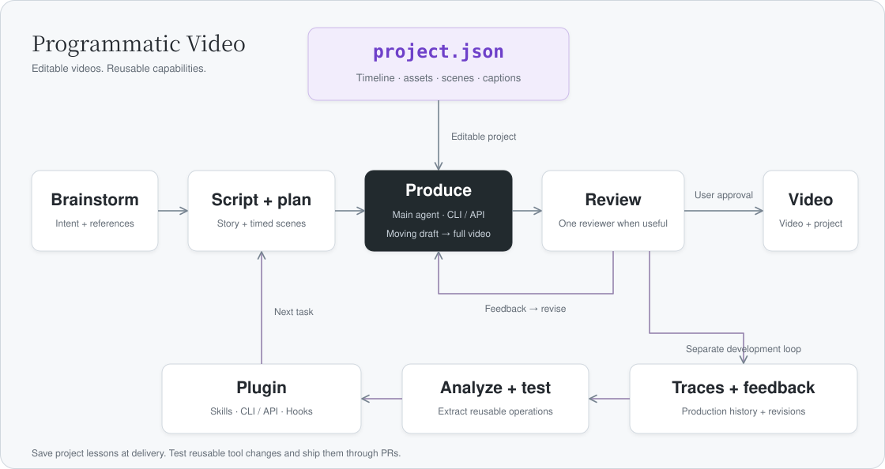
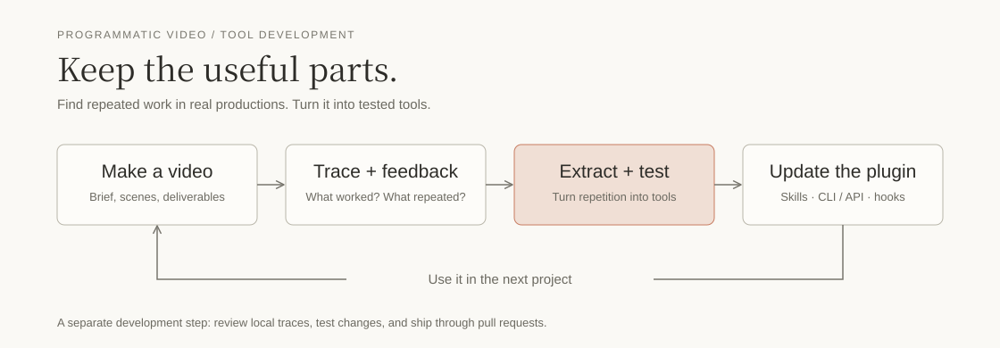

# Programmatic Video

[](https://x.com/YZLin151776) [](https://www.douyin.com/search/47421190572?type=user)

[English](README.md) | [简体中文](README.zh-CN.md)

**Make editable videos with an AI coding agent.**

An open-source plugin for Codex and Claude Code. Turn lyrics, narration or an idea into pixel animation, illustrated scenes or motion graphics, using reusable skills and video tools.

**Still early.** We're improving it through real video projects. Try it, share feedback, or help build the next useful tool. Issues and pull requests are welcome.

## How it works



Each video has its own directory and one `project.json` connecting the timeline, assets, scene code and captions. Your agent makes the video; one reviewer can help check it.

Canvas composes frames from reusable assets, and FFmpeg encodes the video. You can revise the scene code, timing or subtitles without generating every frame from scratch.

## Get started

You'll need Node.js 20+, FFmpeg with ffprobe, and Chrome, Edge or Playwright Chromium.

```sh
git clone https://github.com/Ol1ver0413/programmatic-video-plugin.git
cd programmatic-video-plugin
npm install --global .
programmatic-video doctor
```

Then **load the plugin in your host** using the [setup guide](docs/getting-started.md). CLI installation is separate from plugin loading; the package is not published to npm.

Start with `using-programmatic-video` and describe what you want to make:

> Make an illustrated video for this narration. Let's work out the story and try a short moving draft before producing the rest.

## Improving the tools



We review real production traces, turn repeated work into reusable skills and CLI/API tools, then test and ship changes through PRs. `finish` saves project lessons and style examples; long-term preferences require explicit confirmation.

[Setup](docs/getting-started.md) · [Tools](skills/using-programmatic-video/references/toolkit.md) · [Production lessons](docs/production-lessons.md) · [Releases](CHANGELOG.md) · [Contributing](docs/releasing.md) — guides are currently in Chinese.

WorkBuddy / CodeBuddy metadata is included; desktop compatibility and official listing are still unverified. See the [distribution notes](docs/workbuddy.md).

## License

[MIT](LICENSE). Bundled fonts retain their [original licenses](templates/video/assets/fonts/LICENSE.txt).
