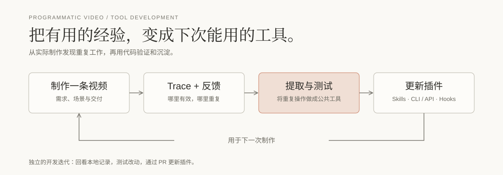

# Programmatic Video

[](https://x.com/YZLin151776) [](https://www.douyin.com/search/47421190572?type=user)

[English](README.md) | [简体中文](README.zh-CN.md)

**和 AI coding agent 一起制作可编辑的视频。**

一个面向 Codex 和 Claude Code 的开源插件。通过可复用的 skill 和视频工具，把歌词、配音或想法做成像素动画、插画场景或动态图形。

**项目仍处于早期。** 我们正在边做视频边打磨。欢迎试用、提反馈，也欢迎通过 Issue 或 PR 一起改进 skill 和工具。

## 怎么工作


每个视频有独立目录，一份 `project.json` 关联时间轴、素材、场景代码和字幕。一个 agent 负责制作，需要时由一个 reviewer 协助检查。

Canvas 用可复用素材编排每一帧，FFmpeg 编码成片。修改场景代码、时间或字幕即可调整视频，不需要每一帧重新生图。

## 开始使用

准备 Node.js 20+、FFmpeg（含 ffprobe），以及 Chrome、Edge 或 Playwright Chromium。

```sh
git clone https://github.com/Ol1ver0413/programmatic-video-plugin.git
cd programmatic-video-plugin
npm install --global .
programmatic-video doctor
```

再按[安装指南](docs/getting-started.md)**将插件加载到宿主**。CLI 安装和宿主加载是两步；目前不向 npm 发布包。

从 `using-programmatic-video` 开始，告诉 agent 想做什么：

> 给这段配音做一条插画视频。我们先聊内容和分镜，做一小段动态小样，再制作后面的部分。

## 工具如何迭代



回看实际制作的 trace 和反馈，把重复工作沉淀为可复用的 skill 和 CLI/API 工具，测试后通过 PR 更新插件。`finish` 保存本片经验和风格案例；长期偏好需要明确确认。

[安装与迁移](docs/getting-started.md) · [CLI 与工程约定](skills/using-programmatic-video/references/toolkit.md) · [制作复盘](docs/production-lessons.md) · [更新记录](CHANGELOG.md) · [贡献与发布规则](docs/releasing.md)

WorkBuddy / CodeBuddy 已有分发元数据，桌面兼容性和官方收录尚未验证，见[分发说明](docs/workbuddy.md)。

## 开源协议

[MIT](LICENSE)。附带字体保留各自的[原有许可证](templates/video/assets/fonts/LICENSE.txt)。
